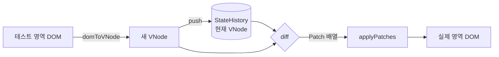
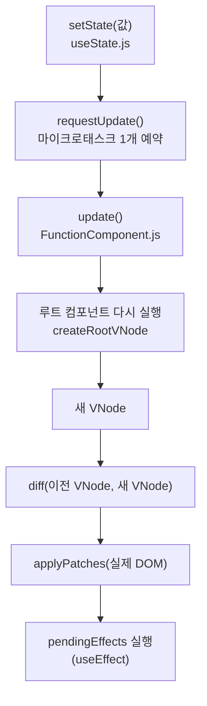

# 미니 리액트 (week-11)

외부 라이브러리 없이 JavaScript(ES Modules)만으로 만든 미니 리액트입니다.
실제 DOM을 가벼운 객체(Virtual DOM)로 바꿔 이전 상태와 비교하고, 바뀐 곳만 실제 DOM에 반영합니다.
그 위에 함수형 컴포넌트와 Hook(`useState`, `useEffect`, `useMemo`)을 올려 상태가 바뀌면 화면이 저절로 갱신되게 했습니다.

- **Phase 1** : DOM ↔ Virtual DOM 변환, Diff, Patch, 변경 이력(뒤로가기·앞으로가기)
- **Phase 2** : 함수형 컴포넌트, Hooks, 할 일 목록 데모
- **차별화** : Batching, Memoization(`memo`, `useCallback`), Selective Rendering, Debouncing(`useDebouncedValue`)

---

## 목차

1. [기능 목록](#1-기능-목록)
2. [폴더 구조와 파일별 역할](#2-폴더-구조와-파일별-역할)
3. [핵심 로직과 동작 흐름](#3-핵심-로직과-동작-흐름)
4. [사용법](#4-사용법)
5. [테스트](#5-테스트)
6. [차별화](#6-차별화)
7. [실행 방법](#7-실행-방법)

---

## 문서

코드보다 협약 문서가 우선합니다.

- [`docs/미니리액트_Phase1.md`](docs/미니리액트_Phase1.md) : 공통 규칙 + Phase 1
- [`docs/미니리액트_Phase2.md`](docs/미니리액트_Phase2.md) : Phase 2
- [`docs/implementation_notes.md`](docs/implementation_notes.md) : 구현 안내 (동작 방식, 규칙을 바꿀 때 고칠 곳, 한계, 보안)

---

## 1. 기능 목록

### Phase 1 : Virtual DOM, Diff, Patch

| 기능 | 설명 | 함수 |
|---|---|---|
| DOM → VNode 변환 | 실제 DOM을 `{ type, tag, props, children }` 객체로 바꾼다. 주석·공백 텍스트·`script`·`style`은 버린다. | `domToVNode` |
| VNode → DOM 생성 | VNode로 새 DOM 노드를 만든다. | `render` |
| 비교 (Diff) | 이전 VNode와 새 VNode를 비교해 바뀐 곳만 담은 Patch 목록을 만든다. | `diff` |
| 반영 (Patch) | Patch 목록을 실제 DOM에 순서대로 적용한다. | `applyPatches` |
| 변경 이력 | Patch할 때마다 VNode를 저장해 뒤로가기·앞으로가기를 한다. | `StateHistory` |

### Phase 2 : 컴포넌트와 Hooks

| 기능 | 설명 | 함수 |
|---|---|---|
| VNode 만들기 | 태그 이름 또는 자식 컴포넌트 함수로 VNode를 만든다. | `createElement` |
| 루트 컴포넌트 관리 | 컴포넌트를 실행해 화면에 붙이고(mount), 상태가 바뀌면 다시 그리고(update), 해제한다(unmount). | `FunctionComponent` |
| 상태 | 렌더링이 끝나도 유지되는 값과, 값을 바꾸면 화면을 다시 그리는 함수를 준다. | `useState` |
| 부수 효과 | DOM 반영이 끝난 뒤 실행할 작업을 등록한다. 다시 실행하기 전·해제할 때 cleanup을 부른다. | `useEffect` |
| 계산 재사용 | 의존성이 같으면 이전 계산 결과를 다시 쓴다. | `useMemo` |

차별화 기능(Batching, Memoization, Selective Rendering, Debouncing)은 [6. 차별화](#6-차별화)에 요약하고, [`docs/차별화.md`](docs/차별화.md)에서 자세히 설명합니다.

### 데모 화면 (`index.html`)

- **Phase 1** : 테스트 영역의 카드를 직접 편집(글자, 줄 추가·삭제, 굵게, 체크박스)한 뒤 **Patch**를 누르면
  바뀐 곳만 실제 영역에 반영된다. **뒤로가기 / 앞으로가기**로 이력을 이동한다.
- **Phase 2** : 할 일 목록. 추가, 완료 토글, 삭제, 필터(전체/진행 중/완료), 검색, 남은 개수 표시,
  탭 제목에 남은 개수 표시(`useEffect`).

---

## 2. 폴더 구조와 파일별 역할

```
week-11/
├── index.html              데모 페이지 (Phase 1 + Phase 2)
├── src/
│   ├── main.js             두 데모를 시작하는 진입점
│   ├── core/               미니 리액트 본체 (데모와 무관한 라이브러리 부분)
│   │   ├── index.js        바깥에 공개하는 함수 모음
│   │   ├── vdom/           DOM ↔ VNode 변환
│   │   ├── diff/           VNode 비교
│   │   ├── patch/          실제 DOM에 반영
│   │   ├── component/      컴포넌트 실행과 갱신
│   │   └── hooks/          useState, useEffect, useMemo 등
│   ├── demos/
│   │   ├── phase_one/      Phase 1 데모 (편집 → Patch → 이력)
│   │   └── phase_two/      Phase 2 데모 (할 일 목록)
│   └── styles/base.css     공통 스타일
├── tests/                  단위·기능 테스트, 극한 규모 테스트
├── docs/                   팀 협약 문서와 구현 안내
└── ai/                     AI별 진입 파일 (CLAUDE.md, GEMINI.md, AGENTS.md)
```

모듈끼리는 아래 방향으로만 의존합니다. `core`는 `demos`를 모릅니다.

```
hooks → component → diff, patch → vdom
demos → core/index.js
```

### `src/core/vdom` : DOM ↔ Virtual DOM

| 파일 | 역할 |
|---|---|
| `nodeTypes.js` | VNode 종류 상수 `NODE_TYPES` (`element`, `text`) |
| `domToVNode.js` | 실제 DOM 노드를 VNode로 바꾼다. 무시할 노드는 `null` |
| `render.js` | VNode로 새 DOM 노드를 만든다. 자식까지 재귀로 만든다 |
| `props.js` | 속성·이벤트를 넣고 빼는 `setProp`, `removeProp`. `render`와 `applyPatches`가 같이 쓴다. `value`, `checked`는 DOM 프로퍼티도 맞춘다 |
| `isIgnoredNode.js` | VNode로 만들지 않을 노드(주석, 공백 텍스트, `script`, `style`)인지 판단. `domToVNode`와 `applyPatches`가 같은 기준을 쓴다 |
| `isVNode.js` | 값이 올바른 VNode 형식인지 자식까지 검사 |
| `cloneVNode.js` | VNode 깊은 복사 |

### `src/core/diff` : 비교

| 파일 | 역할 |
|---|---|
| `patchTypes.js` | Patch 종류 상수 `PATCH_TYPES` |
| `diff.js` | 두 VNode를 루트부터 재귀로 비교해 Patch 배열을 만든다 |

### `src/core/patch` : 반영

| 파일 | 역할 |
|---|---|
| `applyPatches.js` | Patch를 앞에서부터 하나씩 실제 DOM에 적용하고, 적용 후의 루트 노드를 돌려준다 |
| `VisibleChildren.js` | 부모별 "보이는 자식 목록"(무시하는 노드를 뺀 자식)을 한 번만 세고 기억한다 |

### `src/core/component` : 컴포넌트

| 파일 | 역할 |
|---|---|
| `createElement.js` | VNode를 만든다. `tag`가 함수면 자식 컴포넌트로 보고 바로 실행한다 |
| `FunctionComponent.js` | 루트 컴포넌트의 `mount` / `update` / `unmount`, 갱신 예약(`requestUpdate`), Effect 실행 |
| `hookContext.js` | "지금 렌더링 중인 컴포넌트"를 기억. Hook이 어느 컴포넌트의 칸을 쓸지 찾을 때 쓴다 |
| `memo.js` | 자식 컴포넌트를 memo 대상으로 표시 |
| `MemoCache.js` | memo 컴포넌트의 이전 props와 VNode를 기억하고 비교 |

### `src/core/hooks` : Hooks

| 파일 | 역할 |
|---|---|
| `getHookSlot.js` | 모든 Hook이 공통으로 쓰는 "칸 꺼내기". 렌더링 중인지, 칸 종류가 같은지 검사 |
| `isDepsChanged.js` | 의존성 배열이 바뀌었는지 `Object.is`로 비교 |
| `useState.js` | 상태와 상태 변경 함수 |
| `useEffect.js` | DOM 반영 뒤 실행할 작업과 cleanup |
| `useMemo.js` | 계산 결과 재사용 |
| `useCallback.js` | 함수 참조 고정 (memo 자식에게 넘길 핸들러용) |
| `useDebouncedValue.js` | `useState` + `useEffect`(cleanup에서 `clearTimeout`)로 만든 Debouncing Hook |

### `src/demos` : 데모

| 파일 | 역할 |
|---|---|
| `phase_one/app.js` | Phase 1 화면 시작, 버튼 연결, Patch와 이력 이동 |
| `phase_one/StateHistory.js` | VNode 이력 저장 (`push`, `back`, `forward`, `getCurrent` 등) |
| `phase_one/sample.js` | 실제 영역에 처음 넣는 샘플 HTML |
| `phase_two/app.js` | Phase 2 화면 시작. 루트 컴포넌트를 `FunctionComponent`로 mount |
| `phase_two/todoState.js` | 할 일 목록 순수 함수 (`addTodo`, `toggleTodo`, `removeTodo`, `countRemainingTodos`) |
| `phase_two/components/todoApp.js` | 루트 컴포넌트. 상태와 Hook은 여기서만 쓰고 자식에게 props로 내려준다 |
| `phase_two/components/todoForm.js` 외 | 자식 컴포넌트(`todoForm`, `todoSearch`, `todoFilter`, `todoList`, `todoItem`, `todoSummary`). props만 받는 순수 함수 |

---

## 3. 핵심 로직과 동작 흐름

### 3.1. Virtual DOM 형식

```js
// 요소
{ type: 'element', tag: 'li', props: { class: 'item' }, children: [ /* VNode */ ] }
// 텍스트
{ type: 'text', text: '할 일' }
```

### 3.2. Phase 1 흐름 : 편집 → Patch → 이력



`src/demos/phase_one/app.js`의 `patchRealArea`가 이 순서를 그대로 실행합니다.

1. 테스트 영역을 `domToVNode`로 다시 읽는다.
2. 이력의 현재 VNode와 `diff`한다. Patch가 없으면 아무것도 하지 않는다.
3. `applyPatches`로 실제 영역에 반영한다.
4. 새 VNode를 `StateHistory`에 `push`한다.

뒤로가기·앞으로가기(`moveHistory`)는 "현재 VNode ↔ 이동할 VNode"를 `diff`해 실제 영역에 반영합니다.

### 3.3. `diff` : 무엇을 비교하는가 (`src/core/diff/diff.js`)

루트부터 재귀로 내려가며 노드 하나씩 비교합니다.

| 상황 | 만드는 Patch |
|---|---|
| 같은 VNode 객체 | 없음 (그 아래를 비교하지 않음, Selective Rendering) |
| 종류(`type`)나 `tag`가 다름 | `REPLACE` 하나 (그 아래는 보지 않음) |
| 텍스트 내용이 다름 | `UPDATE_TEXT` |
| 같은 태그인데 props가 다름 | `UPDATE_PROPS` (`set`: 추가·변경, `remove`: 삭제) |
| 자식이 늘어남 | `INSERT` (index 오름차순) |
| 자식이 줄어듦 | `REMOVE` (index 내림차순) |

자식은 **같은 인덱스끼리** 비교합니다. Patch는 `{ type, path, ... }` 모양이고, `path`는 루트에서 그 노드까지 자식 인덱스 배열입니다. (예: `[2, 0]` = 루트의 세 번째 자식의 첫 번째 자식)

### 3.4. `applyPatches` : 어떻게 반영하는가 (`src/core/patch/applyPatches.js`)

- **먼저 전부 검사, 그다음 적용** : Patch 종류·모양이 틀리면 DOM을 하나도 바꾸기 전에 `TypeError`를 던진다.
- **`path`로 노드 찾기** : `childNodes`를 따라가되 `isIgnoredNode`가 무시하는 노드(주석, 공백 텍스트 등)는
  건너뛰고 센다. `domToVNode`가 버린 노드를 똑같이 건너뛰어야 VNode 인덱스와 DOM 위치가 맞는다.
- **O(N²) 피하기** : 같은 부모 아래 Patch가 많을 때 매번 자식을 다시 세지 않도록 `VisibleChildren`이
  목록을 기억하고, DOM을 바꿀 때 목록도 같이 고친다.
- **종류별 적용 함수를 `Map` 표로** : `PATCH_APPLIER_BY_TYPE`. 새 Patch 종류는 표에 한 줄을 더한다.
- 루트가 `REPLACE`되면 새 루트 노드를 돌려준다.

### 3.5. Phase 2 흐름 : 상태 변경 → 화면 갱신



Phase 2는 화면 반영에 Phase 1의 `render`, `diff`, `applyPatches`를 그대로 씁니다.
`mount()`는 처음 한 번 `render`로 DOM을 만들고, 이후 `update()`는 `diff` + `applyPatches`로 바뀐 곳만 고칩니다.

### 3.6. Hook 값이 유지되는 원리

루트 컴포넌트마다 `FunctionComponent` 인스턴스가 **`hooks` 배열 하나와 `hookIndex`** 를 가집니다.

```
렌더링 시작 → hookIndex = 0
useState('')   → hooks[0] 사용, hookIndex = 1
useState([])   → hooks[1] 사용, hookIndex = 2
useEffect(...) → hooks[2] 사용, hookIndex = 3
```

- 렌더링할 때마다 `hookIndex`를 0으로 되돌리고 **같은 순서로 같은 칸**을 다시 찾아간다. 그래서 컴포넌트 함수가
  다시 실행되어도 값이 남는다.
- 그래서 Hook을 조건문 안에서 부르면 칸이 어긋난다. 이를 두 곳에서 잡는다.
  - `getHookSlot` : 같은 칸에 다른 종류의 Hook이 오면 `Error`
  - `FunctionComponent.assertHookCountUnchanged` : 렌더링이 끝났을 때 Hook을 덜 불렀으면 `Error`
- 칸 모양
  - `useState` : `{ kind: 'state', value, setValue }` (`setValue`는 처음 한 번만 만들어 늘 같은 함수)
  - `useEffect` : `{ kind: 'effect', dependencies, cleanup }`
  - `useMemo` : `{ kind: 'memo', dependencies, value }`
- 의존성 비교는 `isDepsChanged` 한 곳. 생략하면 매번, `[]`이면 처음 한 번만, 값이 있으면 `Object.is`로 바뀔 때.

### 3.7. `useState` → 화면 갱신

`src/core/hooks/useState.js`의 `changeState`

1. 렌더링 중에 부르면 `Error` (무한 렌더링 방지)
2. 해제된 컴포넌트의 옛 함수면 무시
3. 새 값이 `Object.is`로 같으면 아무것도 하지 않음
4. 값을 바로 바꾸고 `component.requestUpdate()` 호출

`requestUpdate`는 바로 다시 그리지 않고 갱신을 예약만 합니다. 자세한 내용은 [`docs/차별화.md`](docs/차별화.md)의 "1. Batching"에 있습니다.

### 3.8. `useEffect` 실행 시점

- 렌더링 중에는 실행하지 않고 `pendingEffects`에 넣어 둔다.
- DOM 반영이 끝난 뒤 등록 순서대로 실행한다. 각 Effect는 실행 직전에 자기 이전 cleanup을 먼저 부른다.
- `unmount()`는 남은 cleanup을 모두 부른다. 하나가 에러를 던져도 나머지를 끝까지 부른 뒤 첫 에러를 던진다.

Memoization과 Selective Rendering은 [6. 차별화](#6-차별화)와 [`docs/차별화.md`](docs/차별화.md)에 있습니다.

---

## 4. 사용법

모든 공개 함수는 `src/core/index.js`에서 가져옵니다.

```js
import {
  createElement, FunctionComponent,
  useState, useEffect, useMemo, useCallback, memo,
} from './src/core/index.js';

// 자식 컴포넌트 : props만 받아 VNode를 돌려주는 순수 함수
const counterText = memo(({ count }) => createElement('p', null, `횟수 : ${count}`));

// 루트 컴포넌트 : State와 Hook은 여기서만 쓴다
function counterApp() {
  const [count, setCount] = useState(0);
  const isEven = useMemo(() => count % 2 === 0, [count]);
  const onClick = useCallback(() => setCount((previous) => previous + 1), []);

  useEffect(() => {
    document.title = `횟수 ${count}`;
  }, [count]);

  return createElement('div', null,
    createElement(counterText, { count }),
    createElement('p', null, isEven ? '짝수' : '홀수'),
    createElement('button', { onClick }, '+1'),
  );
}

const app = new FunctionComponent(counterApp, {}, document.querySelector('#root'));
app.mount();
```

Phase 1 함수만 따로 쓸 수도 있습니다.

```js
import { domToVNode, render, diff, applyPatches } from './src/core/index.js';

const before = domToVNode(document.querySelector('#card'));
const after = { ...before, props: { ...before.props, class: 'done' } };

const patches = diff(before, after);  // [{ type: 'UPDATE_PROPS', path: [], set: { class: 'done' }, remove: [] }]
applyPatches(document.querySelector('#card'), patches);
```

### 지원하는 속성·이벤트

- 속성 값 : 문자열, 불리언(`true` → 빈 문자열 속성, `false`·`null`·`undefined` → 제거), 함수(이벤트)
- 이벤트 : `onClick`처럼 `on` + 이벤트 이름. 바뀌면 이전 리스너를 빼고 새로 단다.
- `on`으로 시작하는 키에 문자열이 오면 `TypeError` (`onclick="..."` 문자열 실행 방지)
- `style`은 문자열만 지원

---

## 5. 테스트

```bash
npm install
npm test
```

- Node에서 jsdom으로 브라우저 환경을 만들어 실행합니다. (`tests/runNodeTests.js`)
- 브라우저에서는 로컬 서버를 띄운 뒤 `/tests/index.html`을 엽니다. 둘 다 같은 목록(`tests/index.js`)을 씁니다.
- 현재 **209개 통과**

| 폴더 | 확인하는 것 |
|---|---|
| `tests/core/vdom` | `domToVNode`, `render`, `props`, `cloneVNode` |
| `tests/core/diff` | Patch 종류별 생성, 같은 객체 건너뛰기 |
| `tests/core/patch` | Patch 적용, 무시 노드가 섞인 path, 에러 시 DOM 보존 |
| `tests/core/component` | `createElement`, `FunctionComponent` 생명주기, Batching, `memo` |
| `tests/core/hooks` | 각 Hook의 값 유지, 의존성, cleanup, Hook 순서 에러 |
| `tests/demos` | `StateHistory`, Phase 1 화면, 할 일 목록 기능, `todoState` 순수 함수 |

**극한 규모 테스트** : 로컬 서버에서 `/tests/stress/index.html`을 엽니다.
깊이(N겹 중첩), 너비(자식 N개 변경·삽입·삭제), 큰 트리 비교, 긴 글자, 속성 N개, 이력 N개 등을 규모를 키워 가며 시간을 잽니다.

---

## 6. 차별화

상태를 루트 컴포넌트만 가지므로, 상태 하나만 바뀌어도 루트 실행 → 자식 전체 실행 → 전체 diff가 일어납니다.
이 비용을 단계별로 줄이는 기능 네 가지를 추가했습니다. 자세한 설명과 측정은 [`docs/차별화.md`](docs/차별화.md)에 있습니다.

**① Batching** (`FunctionComponent.requestUpdate`)
- 한 이벤트에서 상태를 여러 번 바꿔도 `queueMicrotask`로 갱신을 한 번만 예약해 `update()`를 한 번만 실행한다.
- 할 일 추가처럼 상태 2개(`setTodos`, `setDraftText`)가 바뀌는 경우 화면 갱신이 2번 → 1번으로 줄고, 중간 화면이 보이지 않는다.
- 할 일 1,000개 기준 7.4ms → 4.3ms.

**② Memoization** (`memo`, `MemoCache`, `useCallback`)
- `memo`로 감싼 자식 컴포넌트는 props가 이전과 같으면 실행하지 않고 이전 VNode 객체를 그대로 쓴다.
- 핸들러는 `useCallback`으로 참조를 고정해야 memo가 "props가 같다"고 판단한다.
- 할 일 1,000개 중 하나 체크 시 `todoItem` 실행 1,000번 → 1번, 22.7ms → 4.5ms.

**③ Selective Rendering** (`diff.js`의 `diffNode`)
- 이전 VNode와 새 VNode가 같은 객체면 그 아래는 비교하지 않고 바로 넘어간다.
- VNode는 만든 뒤 수정하지 않으므로 "같은 객체 = 같은 내용"이 성립해 안전하다.
- memo가 돌려준 이전 VNode가 여기서 걸러져, 실행(②)과 비교(③)를 함께 건너뛴다.

**④ Debouncing** (`useDebouncedValue`)
- 값이 정한 시간(데모 검색창은 300ms) 동안 더 바뀌지 않을 때만 따라 바뀌는 Hook으로, `useState` + `useEffect`(cleanup에서 `clearTimeout`)만 조합해 만들었다.
- 검색창 글자는 바로 보이고, 목록을 거르는 검색어만 입력이 멈춘 뒤에 바뀐다.
- 치는 동안의 중간 검색어로 목록을 다시 거르지 않고, 그동안 목록 VNode는 ②·③ 덕분에 통째로 재사용된다.

---

## 7. 실행 방법

ES Modules를 쓰므로 `file://`로 열면 동작하지 않습니다. 저장소 루트에서 로컬 정적 서버를 띄웁니다.

```bash
npx serve .
```

```bash
python3 -m http.server 8000
```

### AI 진입 파일

AI별 진입 파일은 `ai/` 폴더에 있습니다. 루트에 없어 자동으로 읽히지 않으므로, 작업을 시작할 때 먼저 읽게 합니다.

- Claude : `ai/CLAUDE.md 를 읽고 시작해`
- Gemini : `ai/GEMINI.md 를 읽고 시작해`
- GPT(Codex 등) : `ai/AGENTS.md 를 읽고 시작해`
