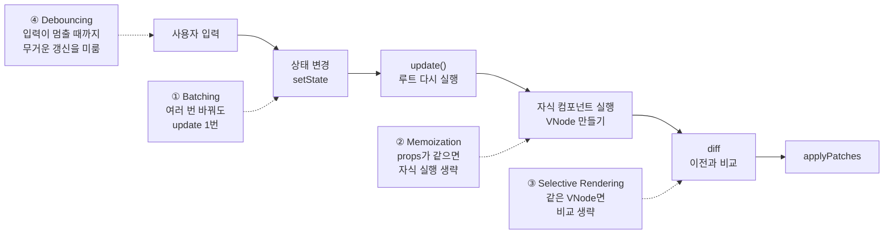

# 차별화 : Batching, Memoization, Selective Rendering, Debouncing

미니 리액트에 협약 기본 기능 외에 추가로 넣은 네 가지 기능을 설명합니다.
전체 구조와 기본 동작은 [README](../README.md)를 먼저 읽어 주세요.

## 목차

0. [왜 이 네 가지를 만들었나](#0-왜-이-네-가지를-만들었나)
1. [Batching : 여러 번 바꿔도 한 번만 그린다](#1-batching--여러-번-바꿔도-한-번만-그린다)
2. [Memoization : props가 같으면 자식을 다시 실행하지 않는다](#2-memoization--props가-같으면-자식을-다시-실행하지-않는다)
3. [Selective Rendering : 같은 VNode면 비교하지 않는다](#3-selective-rendering--같은-vnode면-비교하지-않는다)
4. [Debouncing : 입력이 멈춘 뒤에만 목록을 거른다](#4-debouncing--입력이-멈춘-뒤에만-목록을-거른다)
5. [네 기능이 함께 동작하는 장면](#5-네-기능이-함께-동작하는-장면)

---

## 0. 왜 이 네 가지를 만들었나

우리 구조에서는 **상태를 루트 컴포넌트만 가집니다.** (협약: 자식은 props만 받는 순수 함수)
구조가 단순한 대신, 상태가 하나만 바뀌어도 아래 일이 **매번 전부** 일어납니다.

1. 루트 컴포넌트가 다시 실행된다.
2. 그 안의 자식 컴포넌트도 전부 다시 실행되어 VNode 트리 전체가 새로 만들어진다.
3. `diff`가 새 트리 전체를 이전 트리와 비교한다.

할 일이 1,000개면 체크박스 하나를 눌러도 할 일 1,000개를 다시 만들고 다시 비교합니다.
그래서 이 비용을 **단계별로 하나씩 줄이는** 기능 네 가지를 넣었습니다.



| 기능 | 줄이는 것 | 한 줄 요약 | 코드 |
|---|---|---|---|
| ① Batching | 렌더링 **횟수** | 상태를 여러 번 바꿔도 화면 갱신은 한 번 | `FunctionComponent.requestUpdate`, `useState.js` |
| ② Memoization | 자식 컴포넌트 **실행** | props가 같으면 이전 VNode를 그대로 쓴다 | `memo.js`, `MemoCache.js`, `useCallback.js` |
| ③ Selective Rendering | **비교** 범위 | 같은 VNode 객체면 그 아래는 비교하지 않는다 | `diff.js`의 `diffNode` |
| ④ Debouncing | 무거운 갱신의 **빈도** | 입력이 멈춘 뒤에만 목록을 거른다 | `useDebouncedValue.js` |

네 기능은 따로 노는 게 아니라 **서로 맞물려** 동작합니다. ②가 같은 VNode 객체를 돌려줘야 ③이 건너뛸 수 있고,
④로 검색어가 그대로인 동안에는 ②·③ 덕분에 목록 전체가 건너뛰어집니다. (5장)

> 아래 측정은 Node + jsdom 환경에서 7번 잰 값의 중앙값입니다. 실행하는 PC와 브라우저에 따라 숫자는 달라지지만,
> **실행 횟수(몇 번 실행되는가)는 환경과 상관없이 같습니다.**

---

## 1. Batching : 여러 번 바꿔도 한 번만 그린다

**문제**

할 일을 하나 추가하면 상태가 두 개 바뀝니다. 목록(`setTodos`)과 입력창 비우기(`setDraftText`)입니다.
상태가 바뀔 때마다 바로 `update()`하면 같은 이벤트 안에서 화면 전체를 **두 번** 다시 그립니다.
첫 번째 렌더링 결과(목록은 늘었는데 입력창은 그대로인 화면)는 사용자가 볼 일도 없는 중간 상태입니다.

**해결 방법**

상태 변경 함수는 값만 바꾸고, 화면 갱신은 **예약**만 합니다. 예약은 한 번만 합니다.

```js
// src/core/component/FunctionComponent.js
requestUpdate() {
  if (!this.isMounted || this.isUpdateScheduled) {
    return;                       // 이미 예약돼 있으면 또 예약하지 않는다
  }
  this.isUpdateScheduled = true;
  queueMicrotask(() => this.flushUpdate());   // 지금 이벤트 처리가 끝나면 한 번 실행
}
```

```
클릭 핸들러 실행
  ├ setTodos(...)      → 값 변경, requestUpdate() → 예약 (깃발 ON)
  ├ setDraftText('')   → 값 변경, requestUpdate() → 이미 예약됨, 무시
  └ 핸들러 끝
마이크로태스크 → flushUpdate() → update() 1번
```

**왜 `setTimeout`이 아니라 마이크로태스크(`queueMicrotask`)인가**

- 마이크로태스크는 지금 실행 중인 코드가 끝나자마자, 브라우저가 화면을 그리기 **전에** 실행됩니다.
- `setTimeout`은 브라우저가 한 번 화면을 그린 뒤에 실행될 수 있어, 옛 화면이 잠깐 보이거나 반응이 늦어집니다.

**좋은 점**

- 이벤트 하나에 렌더링 한 번. 상태를 몇 개 바꾸든 루트 실행, VNode 생성, diff, DOM 반영이 한 번씩만 일어납니다.
- 사용자는 중간 상태를 보지 않고 최종 결과만 봅니다.
- 상태 값은 **바로** 바뀝니다. 그래서 `setCount(c => c + 1)`을 두 번 부르면 두 번째 함수가 첫 번째 결과를 받아 정확히 2가 늘어납니다.
- 같은 값(`Object.is`)으로 바꾸면 예약 자체를 하지 않습니다.

**측정** (할 일 추가 = 상태 2개 변경, memo 켠 상태)

| 할 일 개수 | 즉시 갱신 (update 2번) | Batching (update 1번) |
|---|---|---|
| 1,000개 | 7.4ms | 4.3ms |
| 5,000개 | 29.6ms | 23.0ms |

**함께 처리한 것**

- setter 직후에는 화면이 아직 그대로입니다. 테스트에서는 `flushUpdate()`로 예약된 갱신을 바로 실행해 확인합니다.
- 예약된 갱신은 이벤트 핸들러가 끝난 뒤 실행되므로, 거기서 난 에러는 핸들러의 `try/catch`가 잡지 못합니다.
  그래서 `instance.onError`를 두어 데모가 에러를 화면에 보여 줍니다. `onError`가 없으면 에러를 그대로 던집니다.
- 예약한 뒤 `unmount()`하면 갱신하지 않습니다.
- 테스트 : `tests/core/component/batching.test.js`

---

## 2. Memoization : props가 같으면 자식을 다시 실행하지 않는다

**문제**

할 일 1,000개 중 하나의 체크박스를 누르면, 바뀐 건 할 일 **1개**인데 `todoItem` 컴포넌트는 **1,000번** 다시 실행됩니다.
루트가 다시 실행되면 그 안의 `createElement(todoItem, ...)`도 전부 다시 불리기 때문입니다.

**해결 방법**

자식 컴포넌트를 `memo()`로 감싸면, 이전 렌더링 때와 props가 같은 경우 컴포넌트를 실행하지 않고 **이전 VNode 객체를 그대로** 돌려줍니다.

```js
// src/demos/phase_two/components/todoItem.js
export const todoItem = memo(({ todo, onToggle, onRemove }) => {
  return createElement('li', /* ... */);
});
```

```
todoApp 다시 실행
  └ createElement(todoItem, { todo, onToggle, onRemove })
       └ MemoCache : 이전 렌더링의 같은 순번 호출과 props를 얕게 비교
            ├ 같음 → todoItem 실행 안 함, 이전 VNode 객체 반환
            └ 다름 → todoItem 실행, 새 VNode
```

- `MemoCache`는 루트 컴포넌트마다 하나 있고, **"어떤 컴포넌트의 몇 번째 호출인가"** 를 기준으로 이전 props와 VNode를 기억합니다.
- props는 얕게 비교합니다. 값은 `Object.is`, 배열(`children` 포함)은 항목끼리 비교합니다.
- 렌더링이 **성공했을 때만** 이번 기록을 다음 비교 기준으로 삼습니다. 렌더링 중 에러가 나면 반쯤 채운 기록이 남지 않습니다.
- 할 일 목록은 불변 방식으로 바꿉니다(`toggleTodo`가 바뀐 할 일만 새 객체로 만듦). 그래서 바뀌지 않은 할 일은
  이전과 **같은 객체**이고, props 비교에서 "같음"이 됩니다.

**`useCallback`이 같이 필요한 이유**

루트가 다시 실행될 때마다 `onToggle = (id) => ...`를 새로 만들면, 함수 내용은 같아도 **참조가 매번 달라** memo가 "props가 바뀌었다"고 판단합니다.
`useCallback`은 의존성이 같은 동안 같은 함수를 돌려줘서 이 문제를 막습니다.

```js
// todoApp.js를 줄인 코드 (실제 코드는 에러를 화면에 보여 주는 createSafeHandler로 한 번 더 감싼다)
const onToggle = useCallback(
  (todoId) => setTodos((todos) => toggleTodo(todos, todoId)),
  [setTodos],      // setTodos는 렌더링이 바뀌어도 같은 함수
);
```

`useState`의 상태 변경 함수는 처음 한 번만 만들어 늘 같은 함수이므로, 의존성에 넣어도 바뀌지 않습니다.
그리고 함수형 갱신(`todos => ...`)을 써서 `todos`를 의존성에 넣지 않아도 되게 했습니다.

**좋은 점**

- 바뀐 할 일 하나만 다시 실행됩니다. 목록이 길수록 효과가 커집니다.
- 자식 컴포넌트를 순수 함수로만 쓰게 한 협약 덕분에 안전합니다. 순수 함수는 같은 props면 항상 같은 결과를 내므로, 실행을 건너뛰어도 결과가 같습니다.

**측정** (할 일 N개 중 하나 체크)

| 할 일 개수 | memo 없음 : `todoItem` 실행 / 시간 | memo 있음 : `todoItem` 실행 / 시간 |
|---|---|---|
| 1,000개 | 1,000번 / 22.7ms | **1번** / 4.5ms (약 5배 빠름) |
| 5,000개 | 5,000번 / 116.0ms | **1번** / 22.4ms (약 5배 빠름) |

데모에서는 `todoForm`, `todoFilter`, `todoList`, `todoItem`, `todoSearch`를 `memo`로 감쌌습니다.

---

## 3. Selective Rendering : 같은 VNode면 비교하지 않는다

**문제**

memo가 `todoItem` 실행을 건너뛰어도, `diff`가 그 VNode 아래를 처음부터 끝까지 비교하면 비교 비용은 그대로 남습니다.

**해결 방법**

`diff`의 맨 앞에 한 줄을 넣었습니다. 이전 VNode와 새 VNode가 **같은 객체**면 그 아래는 볼 필요가 없습니다.

```js
// src/core/diff/diff.js
function diffNode(previousVNode, nextVNode, path) {
  // Selective Rendering
  if (previousVNode === nextVNode) {
    return [];
  }
  // ...
}
```

**왜 안전한가**

- 협약에서 VNode는 **만든 뒤 수정하지 않는다**(불변)고 정했습니다. 그래서 "같은 객체 = 같은 내용"이 항상 성립합니다.
- memo가 돌려준 이전 VNode 객체가 바로 여기서 걸러집니다. ②와 ③은 한 쌍입니다.

**좋은 점**

- 실행(②)뿐 아니라 비교(③)까지 건너뛰므로, 바뀌지 않은 부분은 거의 비용이 들지 않습니다.
- 코드 한 줄이라 Phase 1 구조를 거의 건드리지 않았습니다. Phase 2를 위해 **Phase 1 파일을 수정한 유일한 곳**입니다.
- 테스트 : `tests/core/diff/diffSameReference.test.js`

---

## 4. Debouncing : 입력이 멈춘 뒤에만 목록을 거른다

**문제**

검색창에 "복습하기"를 치면 글자 하나마다 검색어 상태가 바뀝니다. 매번 할 일 전체를 거르고 목록을 다시 만들면,
사용자가 아직 치는 중인 **중간 검색어**("복", "복습", "복습하")로도 목록을 계속 다시 그리게 됩니다.

**해결 방법**

값이 `delayMs` 동안 더 바뀌지 않을 때만 따라 바뀌는 Hook `useDebouncedValue`를 만들었습니다.
**core에 새 기능을 더하지 않고, 이미 만든 `useState` + `useEffect`만 조합**했습니다.

```js
// src/core/hooks/useDebouncedValue.js
export function useDebouncedValue(value, delayMs) {
  const [debouncedValue, setDebouncedValue] = useState(value);

  useEffect(() => {
    const timerId = setTimeout(() => setDebouncedValue(value), delayMs);
    return () => clearTimeout(timerId);   // 값이 또 바뀌면 이전 타이머를 지운다
  }, [value, delayMs]);

  return debouncedValue;
}
```

```
"복" 입력  → 타이머 시작
"복습" 입력 → cleanup이 이전 타이머 취소, 새 타이머 시작
"복습하기"  → 또 취소, 새 타이머
(300ms 동안 입력 없음) → debouncedValue = "복습하기" → 목록 1번 거르기
```

데모(`todoApp.js`)에서는 두 값을 구분해서 씁니다.

- `searchText` : 검색창에 보이는 글자. 바로 바뀌어야 하므로 디바운스하지 않습니다.
- `debouncedSearchText` : 목록을 거르는 검색어. 300ms(`SEARCH_DELAY_MS`) 늦게 따라옵니다.
- 두 값이 다르면 검색창 옆에 "입력이 멈추면 검색해요"를 보여 줍니다.

**좋은 점**

- 치는 동안의 중간 검색어로 목록을 다시 거르지 않고, 마지막 검색어로 한 번만 거릅니다.
- 입력창 글자는 바로 바뀌므로 사용자가 느끼는 반응 속도는 그대로입니다.
- Hook을 조합해 새 Hook을 만들 수 있다는 것을 보여 줍니다. `useEffect`의 cleanup이 왜 필요한지 보여 주는 예이기도 합니다.
- 테스트 : `tests/core/hooks/useDebouncedValue.test.js` (`tests/fakeTimers.js`로 300ms를 실제로 기다리지 않고 확인)

---

## 5. 네 기능이 함께 동작하는 장면

검색창에 글자를 하나 칠 때 일어나는 일입니다.

1. `setSearchText` → **Batching**으로 갱신 1번 예약
2. `todoApp` 다시 실행. 검색어(`debouncedSearchText`)는 아직 그대로라 **Debouncing** 덕분에 `useMemo`가 이전에 거른 목록을 그대로 돌려줌
3. `todoList`의 props(`todos`, `onToggle`, `onRemove`)가 모두 이전과 같으므로 **Memoization**이 이전 VNode 객체를 그대로 돌려줌
4. `diff`가 같은 객체를 보고 목록 전체를 **Selective Rendering**으로 건너뜀
5. 결국 바뀐 검색창 부분만 비교하고 반영함

